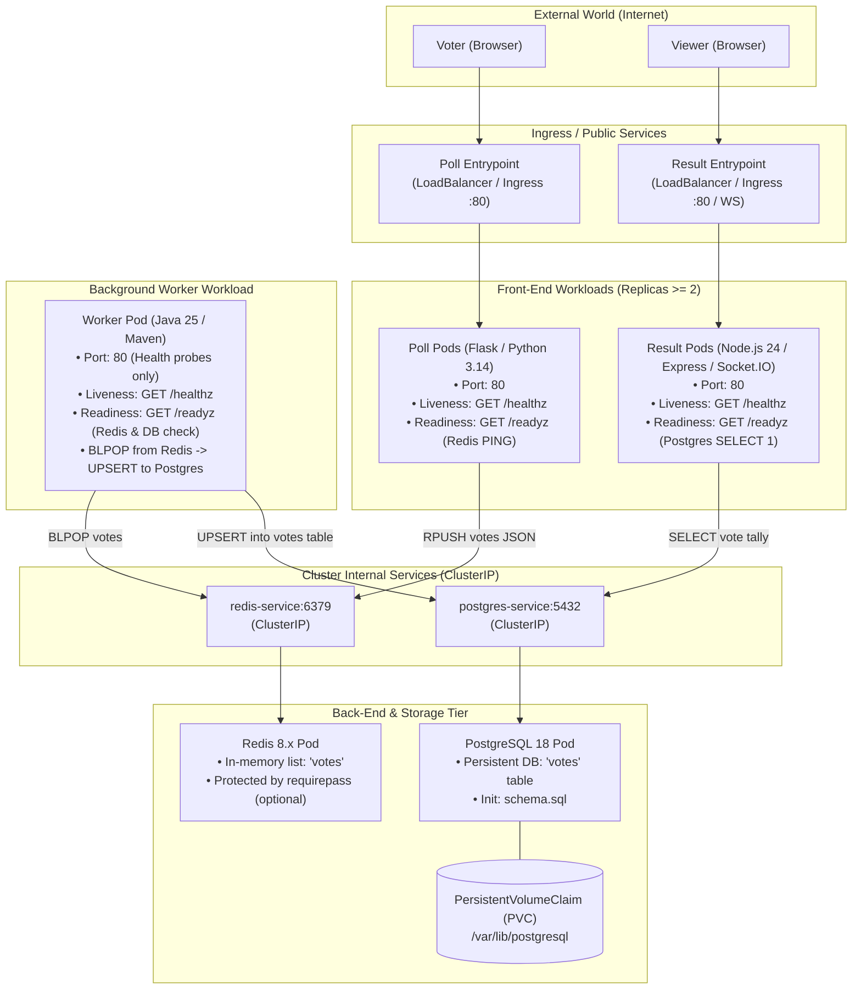

# Bernstein — Orchestrate Your Own Symphony of Containers

[](https://github.com/Nexlein/Bernstein/actions/workflows/ci.yml)
[](https://github.com/Nexlein/Bernstein/actions/workflows/mirror.yml)

> **Epitech Tek3 DevOps Project**  
> Complete Kubernetes orchestration of a distributed microservices voting application (_Poll_, _Redis_, _Worker_, _PostgreSQL_, _Result_) with private registry pipeline, strict zero-downtime updates, and production best practices.

---

## Application Architecture



---

## Quickstart & Local Testing

### 1. Prerequisites

- Docker & Docker Compose (v2+)
- Node.js (v22+)

### 2. Team Setup & Git Hooks

Install root development tools (Husky pre-commit hooks and Prettier):

```bash
npm install
```

_Note: Git hooks will automatically bind upon running `npm install` via Husky._

### 3. Launch Local Multi-Service Stack

Run the entire 5-tier voting stack locally:

```bash
# Start all containers in the background with health checks
docker compose up -d

# Check live logs
docker compose logs -f
```

- **Poll Web UI**: [http://localhost:5000](http://localhost:5000)
- **Result Web UI**: [http://localhost:5001](http://localhost:5001)

### 4. Verify Health Probes

```bash
# Poll probes
curl http://localhost:5000/healthz   # 200 OK
curl http://localhost:5000/readyz    # 200 OK if Redis is up

# Result probes
curl http://localhost:5001/healthz   # 200 OK
curl http://localhost:5001/readyz    # 200 OK if PostgreSQL is up
```

### 5. Tear Down

```bash
docker compose down -v
```

---

## Project Structure

```
├── .claude/                  # AI agent configuration & token-saving code map
│   ├── codemap.md            # Auto-generated services map + file tree
│   └── settings.json         # Claude permissions & read denials
├── .github/
│   ├── dependabot.yml        # Weekly automated dependency checks
│   └── workflows/
│       ├── ci.yml            # Linting, Docker build matrix & integration tests
│       └── mirror.yml        # Automatic mirror to official Epitech repository
├── .husky/                   # Version-controlled Git pre-commit hooks
├── doc/
│   └── subject/              # Official Epitech project PDF & markdown specifications
├── poll-application/         # Source code & Dockerfiles for the 3 services
│   ├── poll/                 # Flask / Python 3.14 voting app
│   ├── result/               # Express / Node.js 24 realtime result app
│   ├── worker/               # Java 25 Maven background worker
│   └── schema.sql            # PostgreSQL database initial schema
├── scripts/
│   └── codemap.mjs           # Automated code map generator script
├── docker-compose.yml        # Local development and CI integration compose file
├── secret.example.yaml       # Template for Kubernetes secrets
├── .env.example              # Template for environment variables
├── CLAUDE.md                 # Agent instructions, architecture & guardrails
├── TODO.md                   # Project implementation checklist & roadmap
└── package.json              # Development scripts (format, codemap, husky)
```

---

## Development & CI/CD Commands

| Command                 | Action                                                                      |
| ----------------------- | --------------------------------------------------------------------------- |
| `npm run codemap`       | Regenerates `.claude/codemap.md` (services, routes, env vars, file tree).   |
| `npm run format:check`  | Checks code and markdown formatting across the entire repo.                 |
| `npm run format`        | Automatically formats all code, manifests, and documentation with Prettier. |
| `docker compose config` | Validates local Docker Compose file syntax.                                 |

---

## Key Requirements & Defense Guardrails

- **Zero-Downtime Rolling Updates**: User-facing services (`poll`, `result`) must maintain 100% availability during rolling deployments (`maxUnavailable: 0`, `readinessProbe` enabled, replicas $\ge 2$).
- **Secret Isolation**: Sensitive credentials (`POSTGRES_PASSWORD`, cloud tokens) are never committed to Git and are configured via Kubernetes Secrets following `secret.example.yaml`.
- **High Availability & Persistence**: PostgreSQL data is mounted on a `PersistentVolumeClaim` (PVC), and all pods specify CPU/Memory resource requests and limits.
