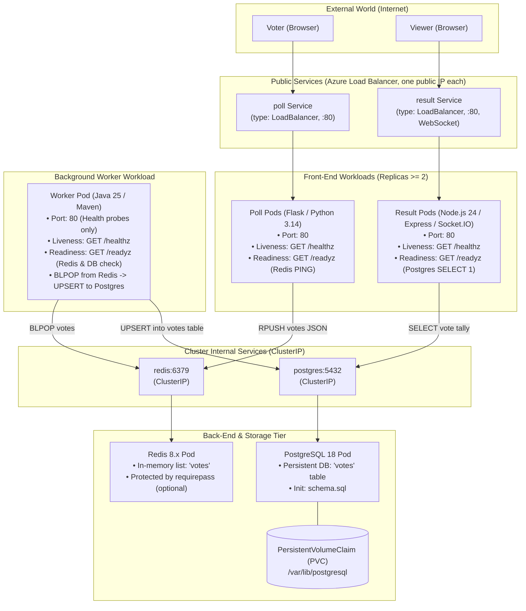

# Bernstein — Orchestrate Your Own Symphony of Containers

[](https://github.com/Nexlein/Bernstein/actions/workflows/ci.yml)
[](https://github.com/Nexlein/Bernstein/actions/workflows/mirror.yml)

> **Epitech Tek3 DevOps Project**  
> Complete Kubernetes orchestration of a distributed microservices voting application (_Poll_, _Redis_, _Worker_, _PostgreSQL_, _Result_) with private registry pipeline, strict zero-downtime updates, and production best practices.

---

## Deploy on Kubernetes (quick start)

Requires `git`, Docker, `kubectl`, the Azure CLI, and an AKS cluster attached to your private registry (`az aks update --attach-acr <registry>`). **Full guide, prerequisites and where each credential goes: [`DEPLOY.md`](DEPLOY.md).** Cluster and registry setup: [`doc/setup/cluster-setup.md`](doc/setup/cluster-setup.md).

```bash
cp k8s/secrets.env.example k8s/secrets.env           # then set POSTGRES_PASSWORD
az aks get-credentials -g <resource-group> -n <cluster>
REGISTRY=<name>.azurecr.io scripts/deploy.sh         # build, push, deploy, wait, print the URLs
```

[`scripts/deploy.sh`](scripts/deploy.sh) builds the 3 images, tags them with the git SHA, pushes them to your registry, deploys `k8s/` with those images and prints the public URLs of Poll and Result. Run it again after a code change to roll out the new version with zero downtime. Options: `scripts/deploy.sh --help`.

---

## Application Architecture



---

## Local Development

Run the 5 services locally with Docker Compose, install the Git hooks and use the repo commands: [`CONTRIBUTING.md`](CONTRIBUTING.md).

How we know it works, what each test proves and does not prove, and how to rerun it: [`CONTRIBUTING.md`, Tests](CONTRIBUTING.md#tests).

---

## Roadmap & Decisions

Work is tracked as GitHub issues, grouped into 4 epics: [Registry & pipeline](https://github.com/Nexlein/Bernstein/issues/43), [K8s manifests](https://github.com/Nexlein/Bernstein/issues/44), [Zero-downtime & resilience](https://github.com/Nexlein/Bernstein/issues/45), [Docs & defense](https://github.com/Nexlein/Bernstein/issues/46). Start from the lowest open issue; dependencies are set as "blocked by".

Technical choices, one Architecture Decision Record (ADR) each, with pros, cons and rejected alternatives: [`doc/adr/`](doc/adr/README.md).

Step-by-step AKS cluster & ACR registry setup guide: [`doc/setup/cluster-setup.md`](doc/setup/cluster-setup.md).

---

## Project Structure

```
├── .claude/              # Agent settings and the generated code map
├── .github/              # CI, Epitech mirror, Dependabot, PR template
├── .husky/               # Pre-commit hook (regenerates the code map)
├── doc/                  # ADRs, cluster setup guide, defense study guide and cheatsheet, subject
├── k8s/                  # Kustomize manifests (deployed by scripts/deploy.sh)
├── poll-application/     # Provided source code and Dockerfiles: Poll, Result, Worker
├── scripts/              # Deploy script, code map generator
├── tests/                # Zero-downtime test
├── docker-compose.yml    # Local 5-service stack, also used by CI
├── CONTRIBUTING.md       # Local development and repo commands
├── DEPLOY.md             # Deployment guide: prerequisites, credentials, deploy
└── CLAUDE.md             # Agent instructions and project rules
```

---

## Key Requirements & Defense Guardrails

- **Zero-Downtime Rolling Updates**: User-facing services (`poll`, `result`) must maintain 100% availability during rolling deployments (`maxUnavailable: 0`, `readinessProbe` enabled, replicas $\ge 2$).
- **Secret Isolation**: Sensitive credentials (`POSTGRES_PASSWORD`, cloud tokens) are never committed to Git and are configured via a Kubernetes Secret generated from `k8s/secrets.env` (template: `k8s/secrets.env.example`).
- **High Availability & Persistence**: PostgreSQL data is mounted on a `PersistentVolumeClaim` (PVC), and all pods specify CPU/Memory resource requests and limits.
