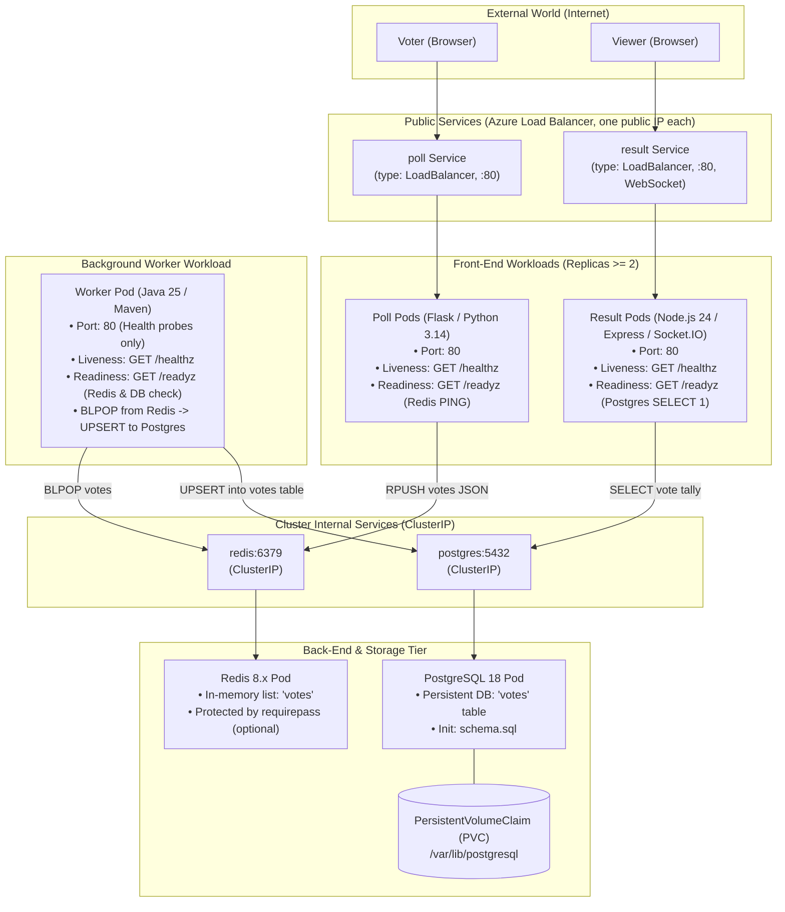

# Bernstein — Orchestrate Your Own Symphony of Containers

[](https://github.com/Nexlein/Bernstein/actions/workflows/ci.yml)
[](https://github.com/Nexlein/Bernstein/actions/workflows/mirror.yml)

> **Epitech Tek3 DevOps Project**  
> Complete Kubernetes orchestration of a distributed microservices voting application (_Poll_, _Redis_, _Worker_, _PostgreSQL_, _Result_) with private registry pipeline, strict zero-downtime updates, and production best practices.

---

## Deploy on Kubernetes (quick start)

Requires `kubectl`, the Azure CLI, and an AKS cluster attached to your private registry (`az aks update --attach-acr <registry>`). Cluster and registry setup: [`doc/setup/cluster-setup.md`](doc/setup/cluster-setup.md).

```bash
cp k8s/secrets.env.example k8s/secrets.env    # then set POSTGRES_PASSWORD
kubectl apply -k k8s/
kubectl -n bernstein get pods -w              # wait until every pod is Ready
kubectl -n bernstein get svc poll result      # EXTERNAL-IP of Poll and Result
```

The images are taken from the registry and tag set in the `images` field of [`k8s/kustomization.yaml`](k8s/kustomization.yaml). A one-command build, push and deploy to your own registry, and the full deployment guide, are in progress (issues #36, #37, #38).

---

## Application Architecture



---

## Quickstart & Local Testing

### 1. Prerequisites

- Docker & Docker Compose (v2+)
- Node.js (v22+)

### 2. Team Setup & Git Hooks

Install root development tools (Husky pre-commit hooks and Prettier):

```bash
npm install
```

_Note: Git hooks will automatically bind upon running `npm install` via Husky._

### 3. Launch Local Multi-Service Stack

Run the entire 5-tier voting stack locally:

```bash
# Start all containers in the background with health checks
docker compose up -d

# Check live logs
docker compose logs -f
```

- **Poll Web UI**: [http://localhost:5000](http://localhost:5000)
- **Result Web UI**: [http://localhost:5001](http://localhost:5001)

### 4. Verify Health Probes

```bash
# Poll probes
curl http://localhost:5000/healthz   # 200 OK
curl http://localhost:5000/readyz    # 200 OK if Redis is up

# Result probes
curl http://localhost:5001/healthz   # 200 OK
curl http://localhost:5001/readyz    # 200 OK if PostgreSQL is up
```

### 5. Tear Down

```bash
docker compose down -v
```

---

## Kubernetes Secrets

The repository holds no password. Before deploying, create `k8s/secrets.env` from the template and fill it in:

```bash
cp k8s/secrets.env.example k8s/secrets.env
```

| Key                 | Required | Effect                                     |
| ------------------- | -------- | ------------------------------------------ |
| `POSTGRES_PASSWORD` | yes      | Password of the PostgreSQL `postgres` user |
| `REDIS_PASSWORD`    | no       | Empty = Redis runs without authentication  |

`k8s/secrets.env` is gitignored. `kubectl apply -k k8s/` turns it into the `app-secrets` Secret and fails if the file is missing. Registry access needs no secret: AKS pulls from ACR through `--attach-acr` (see [ADR 0002](doc/adr/0002-acr-registry.md)).

---

## Roadmap & Decisions

Work is tracked as GitHub issues, grouped into 4 epics: [Registry & pipeline](https://github.com/Nexlein/Bernstein/issues/43), [K8s manifests](https://github.com/Nexlein/Bernstein/issues/44), [Zero-downtime & resilience](https://github.com/Nexlein/Bernstein/issues/45), [Docs & defense](https://github.com/Nexlein/Bernstein/issues/46). Start from the lowest open issue; dependencies are set as "blocked by".

Technical choices, one Architecture Decision Record (ADR) each, with pros, cons and rejected alternatives: [`doc/adr/`](doc/adr/README.md).

Step-by-step AKS cluster & ACR registry setup guide: [`doc/setup/cluster-setup.md`](doc/setup/cluster-setup.md).

---

## Project Structure

```
├── .claude/                  # AI agent configuration & token-saving code map
│   ├── codemap.md            # Auto-generated services map + file tree
│   └── settings.json         # Claude permissions & read denials
├── .github/
│   ├── dependabot.yml        # Weekly automated dependency checks
│   └── workflows/
│       ├── ci.yml            # Linting, Docker build matrix & integration tests
│       └── mirror.yml        # Automatic mirror to official Epitech repository
├── .husky/                   # Version-controlled Git pre-commit hooks
├── k8s/                      # Kustomize manifests (kubectl apply -k k8s/)
│   ├── kustomization.yaml    # Entry point: namespace, images, ConfigMaps, Secret
│   ├── namespace.yaml        # The bernstein namespace
│   ├── postgres.yaml         # PostgreSQL StatefulSet + PVC + ClusterIP Service
│   ├── redis.yaml            # Redis Deployment + ClusterIP Service
│   ├── worker.yaml           # Worker Deployment
│   ├── poll.yaml             # Poll Deployment (2 replicas)
│   ├── result.yaml           # Result Deployment (2 replicas)
│   ├── pdb.yaml              # PodDisruptionBudgets for Poll and Result
│   ├── schema.sql            # Copy of poll-application/schema.sql (checked by CI)
│   └── secrets.env.example   # Template for the Kubernetes Secret (copy to secrets.env)
├── doc/
│   ├── adr/                  # Architecture Decision Records: one file per technical choice
│   ├── defense/              # Defense preparation (study guide, in French)
│   ├── setup/                # Step-by-step AKS cluster & ACR registry setup guide
│   └── subject/              # Official Epitech project PDF & markdown specifications
├── poll-application/         # Source code & Dockerfiles for the 3 services
│   ├── poll/                 # Flask / Python 3.14 voting app
│   ├── result/               # Express / Node.js 24 realtime result app
│   ├── worker/               # Java 25 Maven background worker
│   └── schema.sql            # PostgreSQL database initial schema
├── scripts/
│   └── codemap.mjs           # Automated code map generator script
├── docker-compose.yml        # Local development and CI integration compose file
├── .env.example              # Template for environment variables
├── CLAUDE.md                 # Agent instructions, architecture & guardrails
└── package.json              # Development scripts (format, codemap, husky)
```

---

## Development & CI/CD Commands

| Command                 | Action                                                                      |
| ----------------------- | --------------------------------------------------------------------------- |
| `npm run codemap`       | Regenerates `.claude/codemap.md` (services, routes, env vars, file tree).   |
| `npm run format:check`  | Checks code and markdown formatting across the entire repo.                 |
| `npm run format`        | Automatically formats all code, manifests, and documentation with Prettier. |
| `docker compose config` | Validates local Docker Compose file syntax.                                 |

---

## Key Requirements & Defense Guardrails

- **Zero-Downtime Rolling Updates**: User-facing services (`poll`, `result`) must maintain 100% availability during rolling deployments (`maxUnavailable: 0`, `readinessProbe` enabled, replicas $\ge 2$).
- **Secret Isolation**: Sensitive credentials (`POSTGRES_PASSWORD`, cloud tokens) are never committed to Git and are configured via a Kubernetes Secret generated from `k8s/secrets.env` (template: `k8s/secrets.env.example`).
- **High Availability & Persistence**: PostgreSQL data is mounted on a `PersistentVolumeClaim` (PVC), and all pods specify CPU/Memory resource requests and limits.
